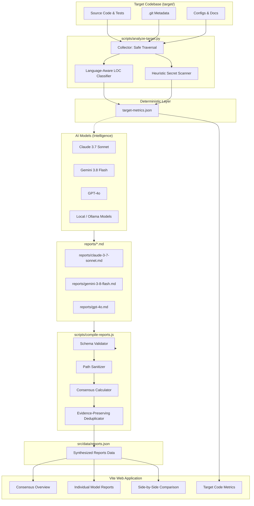

# AI Repository Review Hub Architecture

## Overview & Core Philosophy

The **AI Repository Review Hub** is an open-source, multi-model evaluation framework designed to audit and review target codebases with reproducibility, rigor, and quantitative depth.

A foundational architectural principle of this system is the **separation of concerns between the target repository and the review framework**:
- **Target Repository (`target/`)**: The codebase under investigation. It remains isolated and read-only.
- **Review Framework (`review1/`)**: The execution harness, deterministic collectors, AI review prompts, validation schemas, consensus engine, and interactive dashboard.

---

## The Four-Layer Architecture

The framework is organized into four distinct, loosely coupled layers:

```
┌────────────────────────────────────────────────────────────────────────┐
│                        4. Presentation Layer                           │
│     Interactive Vite/React Dashboard • GitHub Pages • Exportable JSON   │
└───────────────────────────────────▲────────────────────────────────────┘
                                    │ consumes
┌───────────────────────────────────┴────────────────────────────────────┐
│                        3. Intelligence Layer                           │
│   Multi-Model AI Reviews (Claude, Gemini, GPT) • Consensus Engine      │
│   Evidence Clustering • Cross-Model Verification • Confidence Scoring  │
└───────────────────────────────────▲────────────────────────────────────┘
                                    │ informed by
┌───────────────────────────────────┴────────────────────────────────────┐
│                         2. Analyzer Layer                              │
│   Deterministic Line Classification • Heuristic Security Scanner       │
│   Test Suite Detection • Dependency/Configuration Inventory            │
└───────────────────────────────────▲────────────────────────────────────┘
                                    │ extracts from
┌───────────────────────────────────┴────────────────────────────────────┐
│                        1. Collector Layer                              │
│   Target File Hierarchy • Git Commit Metadata • Language Detection     │
│   Directory Exclusion & Safe Path Sanitization                         │
└────────────────────────────────────────────────────────────────────────┘
```

### 1. Collector Layer
- **Responsibility**: Inspect the file system in `target/` safely without modifying target code or executing untrusted scripts.
- **Components**:
  - `find_target_root`: Automatically discovers the target root directory (supporting cloned repositories or subdirectories).
  - `should_exclude_dir`: Granular exclusion engine distinguishing:
    - Version control metadata (`.git`, `.svn`, `.hg`)
    - Dependency directories (`node_modules`, `vendor`, `.venv`, `.cargo`)
    - Build artifacts (`dist`, `build`, `out`, `.next`, `__pycache__`, Rust `target`)
    - IDE metadata (`.vscode`, `.idea`)
  - `get_git_metadata`: Extracts exact commit SHA, short hash, branch, author, commit date, and remote URL.
  - `Path Sanitizer`: Ensures no absolute machine paths (`/Users/...`, `/home/...`) leak into generated artifacts.

### 2. Analyzer Layer
- **Responsibility**: Compute deterministic ground truth before engaging AI models. AI models should never guess line counts or file numbers.
- **Components**:
  - `count_lines_detailed`: Language-aware syntax classifier categorizing lines into:
    - **Physical Lines**: Total raw newline-delimited lines.
    - **Executable Code Lines**: Actual runnable or declarative source code.
    - **Comment Lines**: Language-specific single-line (`#`, `//`, `--`) and multiline comments (`/* */`, `"""`, `<!-- -->`).
    - **Blank Lines**: Whitespace-only lines.
    - **Documentation Lines**: Markdown, AsciiDoc, and reStructuredText documentation.
    - **Data Lines**: JSON, CSV, TSV, and SQL fixtures.
  - `check_security_flaws`: Lightweight, preliminary regex pattern scanner with contextual severity classification (`CRITICAL`, `HIGH`, `MEDIUM`, `LOW`) and masked secret matches.
  - `Artifact Output`: Generates standardized `target-metrics.json` adhering to `schemas/analysis.schema.json`.

### 3. Intelligence Layer
- **Responsibility**: Synthesize AI reasoning, cross-model consensus, and empirical evidence.
- **Components**:
  - **Specialized Prompt Pipeline**: Multi-stage investigation prompts (Discovery, Architecture, Security, Code Quality, Dependencies).
  - **Evidence Classification**:
    - `verified`: Confirmed code finding backed by an exact file, line range, and reproducible snippet.
    - `probable`: Likely risk based on code review, requiring runtime confirmation.
    - `unverified`: Architectural observation or speculative suggestion.
  - **Compiler & Consensus Engine (`scripts/compile-reports.js`)**:
    - Validates model markdown frontmatter against `schemas/report.schema.json`.
    - Computes consensus averages **without treating missing scores as zero** (preserving `null` for unassessed metrics).
    - Clusters security findings based on composite semantic criteria (file path, vulnerability category, title token similarity) and retains original model reports as evidence instances.

### 4. Presentation Layer
- **Responsibility**: Deliver an interactive, fast web dashboard for developers, stakeholders, and auditors.
- **Components**:
  - **Vite + React 19 + Tailwind CSS**: Responsive, dark-themed UI.
  - **Consensus Overview**: Scorecard, multi-model score matrix, and consolidated security vulnerability audit.
  - **Model Reports View**: Full rendered Markdown reports, strengths/weaknesses breakdown, and raw markdown export.
  - **Model Comparison View**: Side-by-side comparative analysis between any two AI models with divergence calculations.
  - **Target Metrics Explorer**: Ground-truth language distribution, granular line category breakdowns, Git commit metadata, and preliminary scanner flags.

---

## Data Flow Diagram



---

## Local vs. Cloud Model Pipeline

The framework is architected to support hybrid workflows:
1. **Local Exploration (e.g. Ollama, DeepSeek, Qwen)**: Fast, offline extraction of repository architecture, symbol maps, and preliminary summaries.
2. **Cloud Models (Claude, Gemini, GPT)**: Deep reasoning, security vulnerability cross-validation, and high-level architectural assessments.
